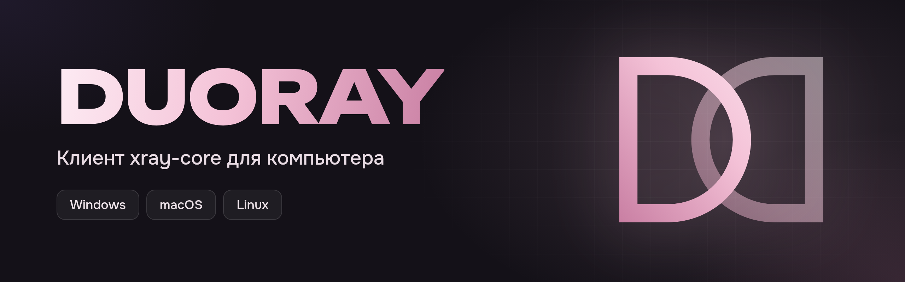
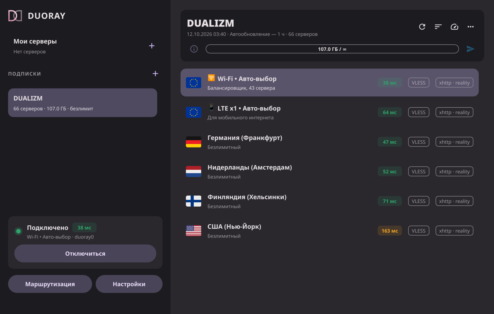

<p align="center">
  
</p>

<p align="center">
  <a href="https://github.com/m-a-prod/DUORAY/releases/latest"></a>
  <a href="https://github.com/m-a-prod/DUORAY/actions/workflows/release.yml"></a>
  <a href="LICENSE"></a>
  
</p>

**DUORAY** — клиент [Xray-core](https://github.com/XTLS/Xray-core) для Windows,
macOS и Linux, сделанный с упором на защиту от утечек DNS.

<p align="center">
  
</p>

## Возможности

**Подписки**
- Полные JSON-конфиги Xray передаются в ядро без упрощений: балансировщики,
  `burstObservatory`, мосты, маршрутизация и DNS панели сохраняются.
  Ссылки `vless://`, `vmess://`, `trojan://`, `ss://` поддерживаются как запасной формат.
- Метаданные панели: название, трафик и срок (`subscription-userinfo`), объявление,
  интервал автообновления, страница подписки и поддержки, описание серверов,
  переезд подписки (`new-url`, `new-domain`) и резервный адрес (`fallback-url`).
- Заголовки запроса: `User-Agent: Duoray/<версия>` и `x-hwid` для панелей с лимитом
  устройств; режим совместимости с Happ.

**Подключение**
- Собственный TUN ([Duotun](https://github.com/m-a-prod/DUOTUN)): весь трафик и DNS
  идут через сервер, DNS-запросы в обход туннеля блокируются
  (pf, nftables, брандмауэр Windows). IPv6 не уходит мимо туннеля.
- Режим системного прокси без TUN: HTTP и SOCKS5 на одном локальном порту.
- Подключение примерно за секунду; права администратора нужны один раз, при
  установке системного помощника.
- Автоматическое восстановление сети при закрытии или сбое приложения.

**Маршрутизация**
- Простой режим: российские сайты, белые списки мобильных операторов, локальная
  сеть и игровые сервисы (Steam и CS2, FACEIT, Riot, Battle.net, Epic, EA, Ubisoft)
  напрямую.
- Продвинутый режим: профили собственных правил по доменам, IP и портам.
- Раздельное туннелирование по приложениям: выбранные программы в обход VPN или
  только они через VPN.
- Пользовательские правила применяются поверх правил подписки, не нарушая их.

**Диагностика и обслуживание**
- Пинг через сам сервер (HTTP GET/HEAD), TCP и ICMP, сортировка по задержке,
  контроль задержки активного подключения.
- Обновления подписываются Ed25519 и устанавливаются по подтверждению пользователя.
- Отчёты об ошибках — только с согласия пользователя, без адресов серверов и ключей.

## Платформы

| Система | Архитектуры | Пакет | Обновление |
|---|---|---|---|
| Windows 10, 11 | x64, x86 | установщик `.exe` | автоматически |
| macOS 11+ | Apple Silicon, Intel | `.dmg` | автоматически |
| Linux (glibc 2.28+) | x86_64, aarch64 | AppImage | автоматически |
| Debian, Ubuntu, Mint | amd64, arm64 | `.deb` | через менеджер пакетов |
| Fedora, openSUSE, RHEL | x86_64, aarch64 | `.rpm` | через менеджер пакетов |
| Arch, CachyOS, Manjaro | x86_64, aarch64 | репозиторий pacman | через менеджер пакетов |

## Установка

Сборки для всех платформ публикуются в
[Releases](https://github.com/m-a-prod/DUORAY/releases/latest).

- **Windows:** запустите установщик. Он установит приложение, Xray-core, драйвер
  Wintun и системный помощник.
- **macOS:** перенесите DUORAY в «Программы». При первом запуске откройте
  приложение через контекстное меню → «Открыть».
- **Linux:** AppImage работает без установки; пакеты ставятся штатно:

```sh
sudo apt install ./duoray_<версия>-1_amd64.deb        # Debian, Ubuntu
sudo dnf install ./duoray-<версия>-1.x86_64.rpm       # Fedora, RHEL
```

**Arch Linux и производные** — подписанный репозиторий:

```sh
curl -fsSL https://duoray.dualizm.space/arch/duoray.asc | sudo pacman-key --add -
sudo pacman-key --lsign-key 13F077054DB026DC11D58144254C5F497BDAC7B9
printf '\n[duoray]\nServer = https://duoray.dualizm.space/arch/$arch\n' | sudo tee -a /etc/pacman.conf
sudo pacman -Sy duoray
```

## Архитектура

```
DUORAY (интерфейс, пользовательские права)
 ├─ подписки, пинг, маршрутизация, обновления
 ├─ Xray-core: SOCKS только на 127.0.0.1, со случайными учётными данными
 └─ локальный сокет / именованный канал
     └─ duoray-helper (системная служба)
         └─ Duotun: TUN, маршруты, DNS, защита от утечек
```

Права администратора есть только у помощника. Он доступен только локально (на
macOS и Linux — только пользователю, установившему DUORAY) и поднимает туннель
только к Xray на 127.0.0.1. Сессия живёт, пока открыто
соединение с приложением: если оно закрыто или аварийно завершилось, помощник
снимает туннель и восстанавливает исходные маршруты и DNS.

| Компонент | Назначение |
|---|---|
| `crates/duoray-core` | подписки, разбор ссылок, сборка конфигурации Xray, протокол помощника |
| `crates/duoray-gui` | приложение `duoray` |
| `crates/duoray-helper` | системный помощник: LaunchDaemon (macOS), служба systemd / OpenRC / runit (Linux), служба Windows |
| [Duotun](https://github.com/m-a-prod/DUOTUN) | TUN-туннель и сетевые настройки |

## Безопасность и приватность

- Отчёты об ошибках отправляются только после явного согласия; отключаются в
  настройках. Ссылки подписок, адреса серверов, ключи и UUID не передаются.
- Обновления проверяются по подписи Ed25519 до установки.
- Xray-core поставляется из официальных релизов с проверкой SHA-256.

Подробнее — в [docs/telemetry.md](docs/telemetry.md). Сообщения об уязвимостях
просим направлять в Telegram [@dualizm_vpn](https://t.me/dualizm_vpn), а не в
публичные Issues.

## Для владельцев панелей

DUORAY показывает описания серверов из панели. Для Remnawave достаточно одного
правила ответа — см. [docs/remnawave.md](docs/remnawave.md).

## Источники данных маршрутизации

| Данные | Источник |
|---|---|
| Российские IP, белые списки IP | [runetfreedom/russia-v2ray-rules-dat](https://github.com/runetfreedom/russia-v2ray-rules-dat) (`geoip:ru`, `geoip:ru-whitelist`), обновляется ежедневно |
| Белые списки доменов | [hxehex/russia-mobile-internet-whitelist](https://github.com/hxehex/russia-mobile-internet-whitelist) |
| Российские домены, игровые сервисы | `geosite.dat` из [v2fly/domain-list-community](https://github.com/v2fly/domain-list-community) |
| Серверы CS2 и Dota 2 | Steam Web API `GetSDRConfig`, подсети Valve (AS32590) |
| Riot, Blizzard | подсети AS6507, AS57976 (RIPEstat) |

## Сборка из исходников

Требования: Rust (stable) и репозиторий [Duotun](https://github.com/m-a-prod/DUOTUN)
в соседнем каталоге.

```sh
git clone https://github.com/m-a-prod/DUOTUN.git
git clone https://github.com/m-a-prod/DUORAY.git
cd DUORAY
cargo build --release -p duoray-helper
cargo run --release -p duoray-gui
```

Для работы нужен `xray`: рядом с бинарником, в `PATH` или в `/usr/lib/duoray` (Linux).

<details>
<summary>Сборка дистрибутивов</summary>

| Цель | Команда | Результат |
|---|---|---|
| Linux AppImage | `packaging/linux/appimage.sh` | `dist/DUORAY-<версия>-x86_64.AppImage` |
| Установка в систему (Linux) | `packaging/linux/install.sh` | `/usr/lib/duoray`, служба помощника |
| Windows | `packaging/windows/build.sh x64` (или `x86`) | `dist/DUORAY-Setup-<версия>-<arch>.exe` |
| macOS | `packaging/macos/build.sh` | `dist/DUORAY-<версия>-macos-<arch>.dmg` |

Установщик Windows собирается на Linux или macOS: нужны `cargo-xwin`, цели
`x86_64-pc-windows-msvc` / `i686-pc-windows-msvc`, LLVM (`llvm-lib`, `lld-link`)
и NSIS (`makensis`). Скрипты загружают официальный Xray-core с проверкой SHA-256.
Релизные сборки для всех платформ выполняет GitHub Actions
(`.github/workflows/release.yml`).

</details>

## Лицензия

DUORAY распространяется по лицензии [GNU GPL v3](LICENSE).
[Дополнительное разрешение](LICENSE-EXCEPTION.md) допускает поставку с драйвером
Wintun. Сторонние компоненты перечислены в [THIRD-PARTY-NOTICES.md](THIRD-PARTY-NOTICES.md),
лицензии Rust-зависимостей — в [THIRD-PARTY-CRATES.txt](THIRD-PARTY-CRATES.txt).

---

<p align="center">Разработка — <b>DUALIZM</b> · <a href="https://t.me/dualizm_vpn">Telegram</a></p>
